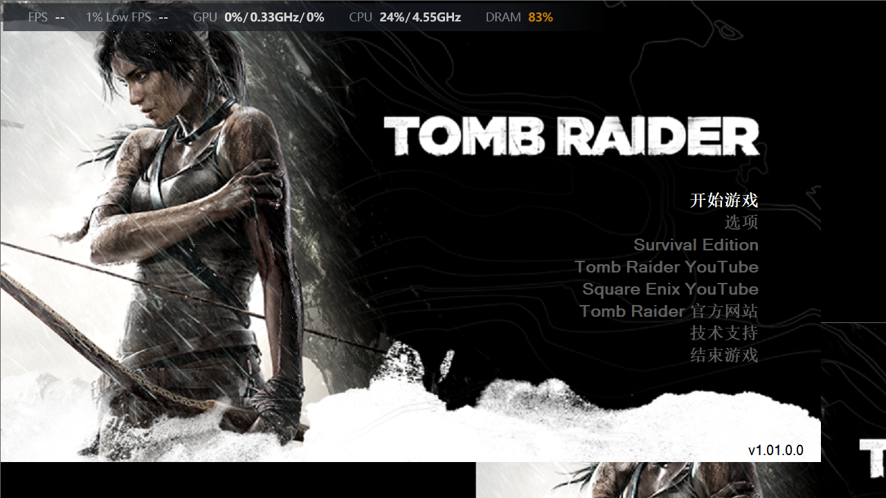
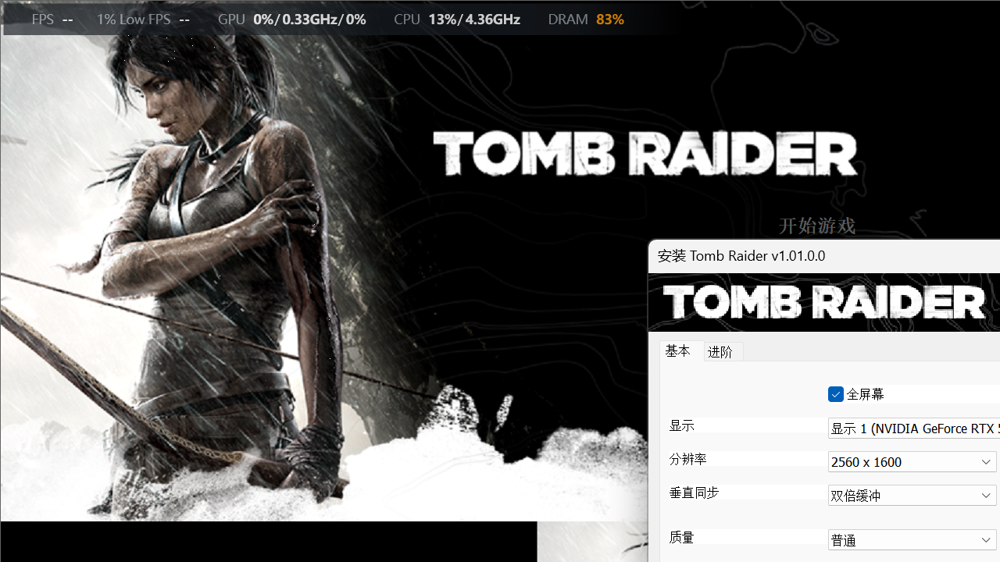

# 古墓丽影9（Tomb Raider 2013）简体中文补丁

把 Steam 版《古墓丽影9》的官方**繁体中文**界面与字幕，一键转成**简体中文**并自动安装。





> 截图来自实测：主菜单「开始游戏 / 选项 / 技术支援 / 结束游戏」，设置页「基本 / 进阶 / 全屏 / 分辨率 / 垂直同步 / 质量」。

## 这个补丁做了什么

游戏本体自带 14 种语言文本，其中繁体中文（`zhhant`）约 **3388 条**，覆盖菜单、字幕、
物品与武器说明、教程提示等全部文本。本补丁：

1. **繁转简全量转换**（OpenCC `t2s`），转换后无繁体残留；
2. **台湾用语 → 大陆用语**，60 余条规则，例如：

   | 官方繁体 | 补丁简体 |
   |---|---|
   | 蘿拉 | 劳拉 |
   | 滑鼠 / 螢幕 | 鼠标 / 屏幕 |
   | 檔案 / 資料夾 | 文件 / 文件夹 |
   | 預設 / 載入 / 儲存 | 默认 / 加载 / 保存 |
   | 驅動程式 / 應用程式 | 驱动程序 / 应用程序 |
   | 解析度 / 畫質 | 分辨率 / 画质 |
   | 進行遊戲 | 运行游戏 |

3. **保留全部按钮图标**：原文里 `<font>` 标签内嵌的 179 个手柄/键位图标字符原样保留；
4. 不改动任何图像、音频、字幕时间轴。

## 为什么不用机翻

官方繁体文本本身通顺、术语统一、标点符合中文习惯，繁转简的效果远好于
「英文机翻成中文」。这也是社区通行做法。

## 环境要求

| 依赖 | 说明 |
|---|---|
| Windows 10/11 | 补丁目标平台 |
| Steam 版《古墓丽影9》 | 支持 GOTY / Survival Edition（Definitive Edition 不支持） |
| [.NET SDK 10](https://dotnet.microsoft.com/download) | 构建文本工具（上游代码用了 C# 14） |
| [Python 3.8+](https://www.python.org/downloads/) | 运行繁转简脚本 |
| [Git](https://git-scm.com/downloads) | 自动拉取上游解包工具 |

## 快速开始（一条命令）

```powershell
# 在仓库根目录执行；如果游戏不在默认路径，加 -GamePath "你的路径"
powershell -ExecutionPolicy Bypass -File scripts\build.ps1
```

脚本会依次完成：

1. 检查环境（dotnet / python / git）；
2. 安装 Python 依赖 `opencc-python-reimplemented`；
3. 克隆上游 [TrRebootModTools](https://github.com/arcusmaximus/TrRebootModTools) 并打上本仓库的修复补丁；
4. 构建文本工具 `TrTextTool`；
5. 从**你自己的游戏目录**提取官方繁体文本；
6. 繁转简并写入 mod 目录；
7. 安装 mod 并合并进 `patch2.000.tiger`（自动备份官方原件）。

完成后直接启动游戏即可。

## 手动步骤

```powershell
# 1. 准备上游工具
git clone https://github.com/arcusmaximus/TrRebootModTools.git tools\TrRebootModTools
cd tools\TrRebootModTools
git apply ..\..\patches\0001-tr2013-localsbin-pointer-size.patch
cd ..\..

# 2. 构建文本工具
dotnet build tools\TrTextTool\TrTextTool.csproj -c Release

# 3. 提取官方繁体文本
dotnet tools\TrTextTool\bin\Release\net8.0\TrTextTool.dll "<游戏目录>" dump "work" zhhant

# 4. 繁转简
python scripts\build_patch.py --input "work\zhhant\pc-w\local\locals.json" --output "mod\pc-w\local\locals.bin\zhhant.json"

# 5. 安装
dotnet tools\TrTextTool\bin\Release\net8.0\TrTextTool.dll "<游戏目录>" install "mod"
```

## 卸载

三种方式任选：

```powershell
# 方式一：用打补丁时自动生成的官方原件还原
cd "E:\SteamLibrary\steamapps\common\Tomb Raider"
copy /y bigfile._orig.patch2.000.tiger patch2.000.tiger
del bigfile._mod.zh-Hans-mod.*

# 方式二：Steam -> 右键游戏 -> 属性 -> 已安装文件 -> 验证游戏文件完整性
```

## 工作原理

```
.tiger 档案
 └─ pc-w\local\locals.bin           ← 二进制文本表：语言 id + 指针数组 + UTF-8 字符串
      ├─ en        (3362 条)
      ├─ zhhant    (3388 条)        ← 本补丁改这一个槽位
      └─ ...
```

1. 用 TrRebootModTools 的 `Shared` 库解析 `.tiger`，取出 `zhhant` 的 `locals.bin`；
2. 转成 JSON，逐条繁转简 + 用语替换；
3. 以 mod 形式写回 `pc-w\local\locals.bin\zhhant.json`（注意：`locals.bin` 在 mod 里是**目录名**，
   文件名是语言代码）；
4. TR2013 没有 `.nfo` 版本机制，mod 必须「扁平化」合并进 `patch2.000.tiger`，
   由 `ModInstaller` 完成，原文件自动备份为 `bigfile._orig.patch2.000.tiger`。

### 为什么要改繁体槽位而不是英文槽位

游戏按语言加载不同字库（`pc-w\fontchinese.drm`、`fontuniversal.drm` 等）。只有中文语言模式
才会加载含汉字字形的字体，所以补丁必须写 `zhhant` 槽位；写进 `en` 槽位会出现方块或缺字。

## 已知问题

- **语音仍是英文**：官方没有中文配音，只有文本被汉化。
- **Steam 验证文件完整性 / 重装游戏后补丁会失效**：`patch2.000.tiger` 被还原成官方版，重新运行一次安装即可。
- **上游工具的 bug 已在本仓库修复**：`Tr2013LocalsBin.Write` 写指针时用 8 字节覆盖 4 字节槽位，
  导致第一条字符串被清零（表现为菜单第一项变成空白）。修复见 `patches/0001-*.patch`，详见
  [docs/技术笔记.md](docs/技术笔记.md)。

## 免责声明

- 本项目**不包含**任何游戏资源文件（`.tiger` / 文本 / 图像），补丁在本地由你自己游戏里的
  官方文本生成。请自行购买正版游戏。
- 仅供个人学习与自用，请勿用于商业用途或二次分发游戏数据。

## 致谢

- [arcusmaximus/TrRebootModTools](https://github.com/arcusmaximus/TrRebootModTools)（MIT）——
  `.tiger` 与 `locals.bin` 的解析、mod 打包与安装
- [OpenCC](https://github.com/BYVoid/OpenCC) —— 繁简转换
- [Ekey/CDCE.TIGER.Tool](https://github.com/Ekey/CDCE.TIGER.Tool) —— 上游工具引用的格式研究

## 许可

本仓库内自有代码采用 MIT 许可证，见 [LICENSE](LICENSE)。
