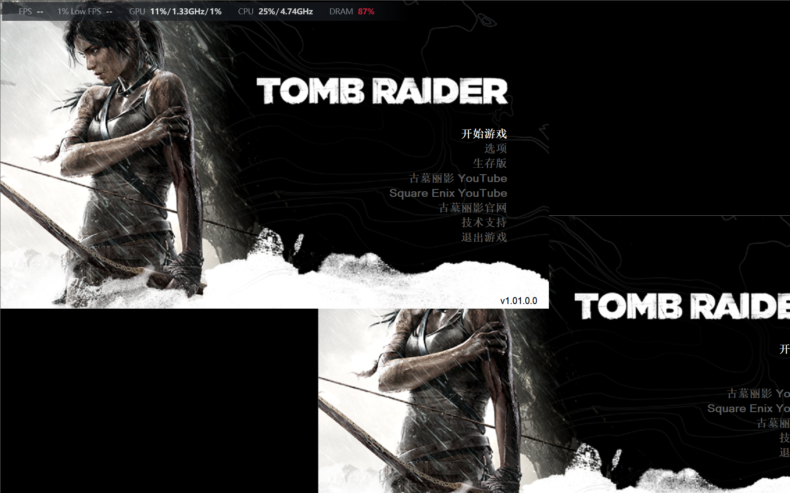
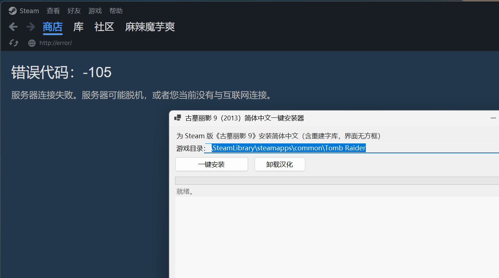
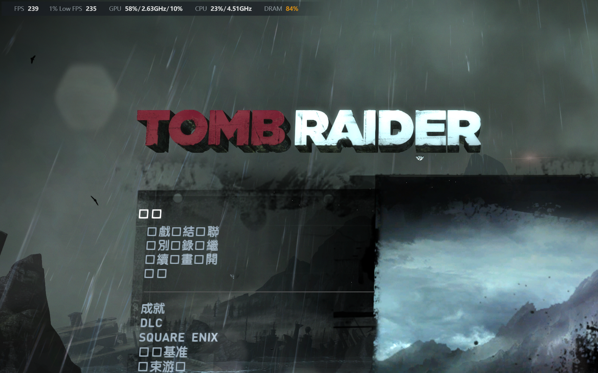

# 古墓丽影9（Tomb Raider 2013）简体中文

《古墓丽影9》（2013，Steam 版）简体中文的**安装工具链**与**技术记录**。



> 实测截图：安装社区汉化包后的主菜单 —— 开始游戏 / 选项 / 生存版 / 技术支持 / 退出游戏，
> **完整简体中文，零方框**。

---

## 快速开始：一键安装器

下载 [Releases](https://github.com/Cai-7/tomb-raider-2013-zh-cn/releases) 里的
`TR2013CnInstaller-v1.0.0.zip`，解压后运行 `TR2013CnInstaller.exe`：



点 **一键安装**，等它跑完，启动游戏并在「语言」设置里选 **Chinese / 中文** 即可。
详细图文步骤见 [docs/安装指南.md](docs/安装指南.md)。

不想用图形界面？`scripts\install-community-mod.ps1` 是同一套逻辑的命令行版本。

---

## 背景：为什么需要"重建字库"的汉化包

游戏本体自带**繁体中文**文本，但它的中文字库是一个**只含繁体字形**的位图字库。
把文本繁转简后，游戏内 UI 会大面积变成「□」方框（实测 31.2% 的汉字缺字形）。

因此**纯文本汉化在这款游戏上不可能成功**，必须同时替换字体资源。

目前唯一成熟可用的方案是社区项目，它用 Noto Sans SC 重建了字库并做了完整翻译：

| 项目 | 地址 |
|---|---|
| 完整汉化（含重建字体） | [intergra/TR2013-Simplified-Chinese](https://github.com/intergra/TR2013-Simplified-Chinese) |
| Nexus 页面 | [mod #207](https://www.nexusmods.com/tombraider2013/mods/207) |
| 官方工具 | [TR2013 Modding Tools / mod #112](https://www.nexusmods.com/tombraider2013/mods/112) |

### 一键安装（推荐）

```powershell
powershell -ExecutionPolicy Bypass -File scripts\install-community-mod.ps1
```

脚本会：自动定位 Steam 里的游戏 → 下载汉化包（v8.0，约 1.1 GB）→ 解压 →
构建 Mod Manager → 安装并合并进 `patch2.000.tiger`。

游戏不在默认位置时：

```powershell
powershell -ExecutionPolicy Bypass -File scripts\install-community-mod.ps1 -GamePath "D:\Games\Tomb Raider"
```

装好后启动游戏，界面与字幕即为简体中文。
**游戏语言需设为 Chinese / 中文**（游戏内「语言」设置，或 Steam 属性 → 语言）。

> 官方要求用 Nexus 上的 **Mod Manager 1.10.0** 安装。本仓库的脚本改用上游源码构建的
> ModManager 命令行方式完成打包（GUI 版本需要交互，本仓库未附带）。
> 实测安装后主菜单为完整简体中文、无方框。社区提醒 1.11.0 可能导致 CG 卡死、
> 文献无声等问题，若遇到请改用 Nexus 的 1.10.0 GUI 工具安装。

### 卸载

```powershell
dotnet tools\TrTextTool\bin\Release\net8.0\TrTextTool.dll uninstall "你的游戏目录"
```

或 Steam → 右键游戏 → 属性 → 已安装文件 → 验证游戏文件完整性。

---

## 本仓库提供什么

| 目录 | 内容 |
|---|---|
| `installer/Tr2013CnInstaller/` | 一键安装器应用（WinForms 图形界面 + 命令行双模式，自包含发布） |
| `docs/安装指南.md` | 面向普通玩家的图文安装指南 |
| `scripts/install-community-mod.ps1` | 同一逻辑的命令行版本（下载 / 解压 / 构建 / 安装） |
| `scripts/build.ps1` | 文本工具链：提取官方繁体 → 繁转简 → 打包成 mod |
| `scripts/build_patch.py` | 繁转简 + 台湾用语本地化，含自检 |
| `tools/TrTextTool/` | `.tiger` / `locals.bin` 提取、安装、校验的命令行工具 |
| `patches/` | 上游 TrRebootModTools 的 `locals.bin` 写入 bug 修复 |
| `docs/技术笔记.md` | 格式解剖、踩坑记录、字体问题的完整调查 |

**本仓库不包含任何游戏资源文件**，也不转载第三方汉化包内容；
汉化包由脚本在安装时从作者官方 Release 下载。

---

## 为什么纯文本方案会失败



> 实证：把菜单项替换成「戏戲结結联聯 / 别別录錄继繼 / 续續画畫开開」后，
> 繁体形（戲 結 聯 別 錄 繼 續 畫 開）正常渲染，简体形（戏 结 联 别 录 继 续 画 开）
> **全部是 □**。

游戏的 UI 字体是 `pc-w\fontchinese.drm` 里一个 4.4 MB 的 Scaleform `pixelFont`
位图图集（内含名为 `fonts_zh_all` 的字符集与约 206 KB 度量表），
**只包含繁体字形**。量化结果：

- 简体文本 40494 个汉字中，**12616 个（31.2%）**在官方繁体文本里从未出现；
- 3388 条字符串中 **2846 条（84%）**至少包含一个这样的字。

即便把中文写进 `en` 槽位也一样：用的是同一套位图字库，方框照样出现。

### 一个容易误判的坑

启动前的标题界面（开始游戏 / 选项 / 技术支持 / 结束游戏）和启动前的设置窗口
显示简体**完全正常** —— 它们走 GDI / DirectWrite 系统字体，不读游戏字库。
**验收必须进入主菜单 / 存档界面 / 游戏内 HUD / 字幕**，
否则会误判为「补丁成功」。

### 顺便一提

本仓库最初的方向是「把官方繁体繁转简」，也确实是这么做的，并且**文本转换本身
完全正确**（3388 条、繁体残留 0、按钮图标 179 个全部保留）。只是被字体卡住了。
若哪天有人重建出覆盖简体的字库，这套文本流水线可以直接复用。

---

## 工具链用法

```powershell
# 提取各语言文本为 JSON
dotnet tools\TrTextTool\bin\Release\net8.0\TrTextTool.dll dump "<游戏目录>" work

# 繁转简（需要 pip install opencc-python-reimplemented）
python scripts\build_patch.py --input "work\zhhant\pc-w\local\locals.json" \
                               --output "mod\pc-w\local\locals.bin\zhhant.json"

# 安装 mod 并合并进 patch2.000.tiger
dotnet tools\TrTextTool\bin\Release\net8.0\TrTextTool.dll install "<游戏目录>" mod

# 校验某个 .tiger 里的文本（注意：必须直接打开文件，不能用 ArchiveSet）
dotnet tools\TrTextTool\bin\Release\net8.0\TrTextTool.dll inspect "<游戏目录>\patch2.000.tiger"
```

---

## 已知问题

- **语音仍是英文**，官方没有中文配音，只有文本与字幕被汉化。
- **Steam 验证文件完整性或重装游戏后补丁会失效**，`patch2.000.tiger` 被还原，
  重新运行安装脚本即可。
- 社区提醒 Mod Manager 1.11.0 可能引发 CG 卡死 / 文献无声 / 返回主菜单异常。
  本仓库脚本用的是 1.11.0 源码构建版；主菜单已实测正常，游戏内表现请自行确认。

---

## 免责声明

- 本项目**不包含**任何游戏资源文件（`.tiger` / 文本 / 图像），汉化包在安装时
  从作者官方 Release 实时下载。请自行购买正版游戏。
- 《Tomb Raider》(2013) 的名称、原始文本、商标、角色、图像、音频、视频、
  资源格式及游戏资产归各自权利人所有。
- 第三方汉化包版权归其作者所有，本仓库仅提供安装脚本与技术记录，
  不修改、不再分发其内容；使用时请遵循该项目的许可条款。
- 仅供个人学习与自用，请勿用于商业用途。

## 致谢

- [intergra/TR2013-Simplified-Chinese](https://github.com/intergra/TR2013-Simplified-Chinese) ——
  完整简体中文翻译与 Noto Sans SC 字体重建（作者 **NoWindNoMoon / 此情无关风月**，
  本项目推荐并唯一使用的汉化包；安装器不内置、不转载其内容，运行时从其官方
  Release 实时下载）
- [arcusmaximus/TrRebootModTools](https://github.com/arcusmaximus/TrRebootModTools)（MIT）——
  `.tiger` 与 `locals.bin` 的解析、mod 打包与安装
- [OpenCC](https://github.com/BYVoid/OpenCC) —— 繁简转换
- [Ekey/CDCE.TIGER.Tool](https://github.com/Ekey/CDCE.TIGER.Tool) —— 上游工具引用的格式研究

## 许可

本仓库自有代码采用 MIT 许可证，见 [LICENSE](LICENSE)。
第三方汉化包与字体（Noto Sans SC / KR，SIL OFL 1.1）遵循各自许可。
