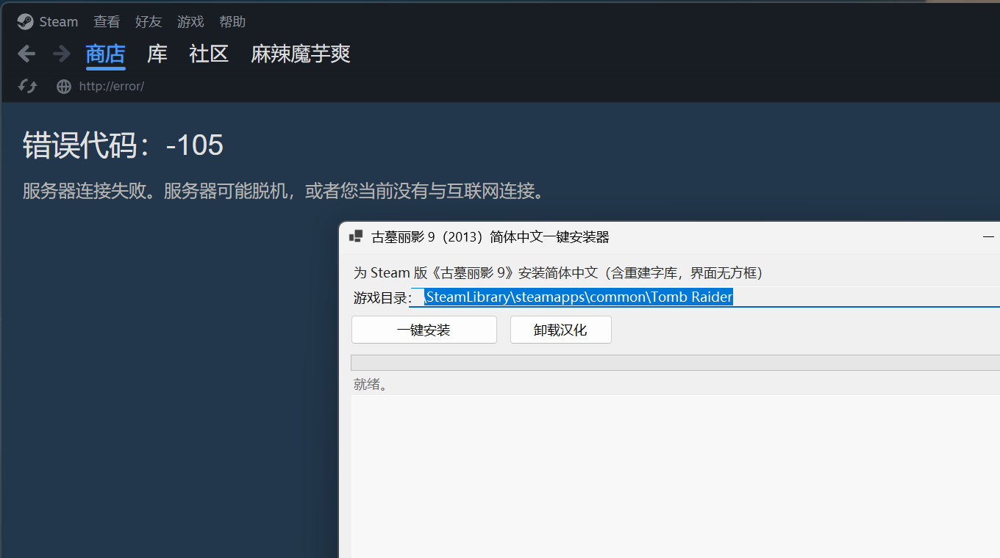
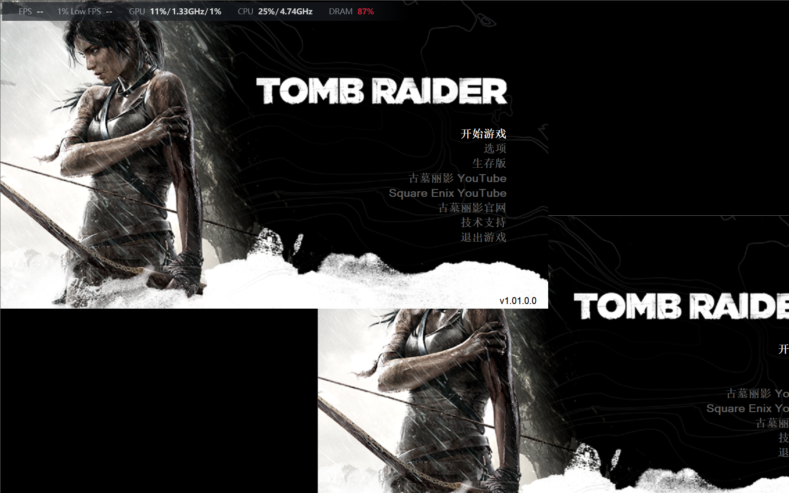

# 图文安装指南 —— 古墓丽影 9（2013）简体中文

> 本指南面向普通玩家。整个过程约 10 分钟（含下载）。
> 语音仍是英文（官方没有中文配音），界面、字幕、物品说明为简体中文。

## 准备

| 需要 | 说明 |
|---|---|
| Steam 版《古墓丽影 9》(Tomb Raider, 2013) | 已安装并能正常运行 |
| 磁盘空间 | 游戏所在盘至少 **8 GB** 可用空间 |
| 网络 | 安装器会从汉化作者官方页面下载约 **1.1 GB** 的汉化包 |

## 第一步：下载安装器

到本项目 [Releases](https://github.com/Cai-7/tomb-raider-2013-zh-cn/releases) 页面，
下载 `TR2013CnInstaller-v1.0.0.zip`，解压到任意目录（**不要**解压到游戏目录）。

解压后应看到两个文件，必须放在一起：

```
TR2013CnInstaller.exe        一键安装器
TR2013_PC_Release.list       档案哈希对照表（安装器运行必需）
```

## 第二步：运行安装器

双击 `TR2013CnInstaller.exe`：



安装器会自动定位 Steam 库里的游戏目录。如果没找到或路径不对，
点 **浏览...** 手动选择包含 `TombRaider.exe` 的文件夹。

确认游戏已完全退出（安装器会检查），然后点 **一键安装**。

## 第三步：等待完成

安装器会依次：下载汉化包 → 校验 → 自动备份官方文件 → 安装 → 自动校验。
全程自动，约 5–10 分钟（视网速）。日志区会实时显示进度：

```
下载完成：...（1097 MB）
正在安装汉化包（重打包需要几分钟，请耐心等待）...
校验：重建字库已就位（18,269,732 字节）
校验：简体文本 3389 条，与汉化包一致 ✓
安装完成 ✓
```

## 第四步：启动游戏

启动 Steam 版《古墓丽影 9》，在 **选项 → 语言** 里选择 **Chinese / 中文**
（如果游戏本来就显示中文，则无需更改）。

主菜单应为：



## 常见问题

<details>
<summary><b>界面还是英文？</b></summary>

把游戏语言设为 Chinese / 中文（游戏内「语言」设置，或 Steam → 右键游戏 →
属性 → 语言）。汉化内容挂在游戏的中文字库槽位上。
</details>

<details>
<summary><b>出现方块（□）缺字？</b></summary>

说明安装不完整（缺哈希对照表或安装中断）。请先卸载，再重新安装一次；
卸载命令见下文。本安装器已内置校验，正常情况下不会出现。
</details>

<details>
<summary><b>语音是英文的？</b></summary>

正常。官方没有中文配音，本汉化只覆盖文本与字幕。
</details>

<details>
<summary><b>Steam 提示验证文件 / 重装游戏后汉化没了？</b></summary>

Steam 会把 `patch2.000.tiger` 还原成官方版。重新运行安装器即可（已下载的
汉化包会复用，不用重新下载）。
</details>

<details>
<summary><b>怎么卸载？</b></summary>

打开安装器点 **卸载汉化**；或命令行：

```
TR2013CnInstaller.exe --uninstall "游戏目录"
```

或 Steam → 右键游戏 → 属性 → 已安装文件 → 验证游戏文件完整性。
</details>

## 不想用安装器？手动安装也可以

仓库里的 `scripts\install-community-mod.ps1` 是同一套逻辑的命令行版本
（需要 .NET SDK 10），适合喜欢折腾的用户，效果完全一样。

## 署名与许可

- **简体中文翻译与重建字库**：[TR2013-Simplified-Chinese](https://github.com/intergra/TR2013-Simplified-Chinese)，作者 **NoWindNoMoon（此情无关风月）**，Nexus 页面 [mod #207](https://www.nexusmods.com/tombraider2013/mods/207)。本安装器不内置、不转载其内容，安装时从其官方发布页实时下载。请遵循其许可条款。
- **档案解析与 mod 打包**：[TrRebootModTools](https://github.com/arcusmaximus/TrRebootModTools)（MIT，arcusmaximus）
- **繁简转换**：[OpenCC](https://github.com/BYVoid/OpenCC)
- **字体**：Noto Sans SC / KR（SIL OFL 1.1）
- 《Tomb Raider》(2013) 版权归 **Square Enix / Crystal Dynamics** 所有。本项目仅供个人学习交流，禁止商业用途。
